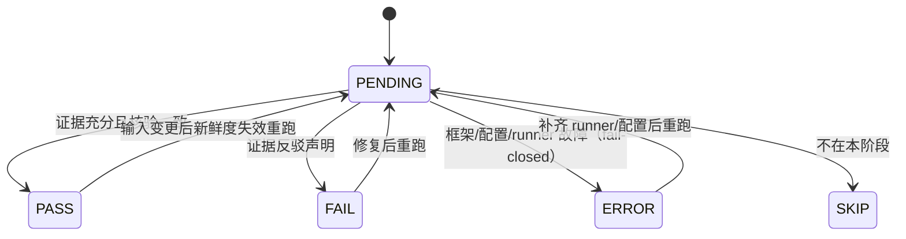
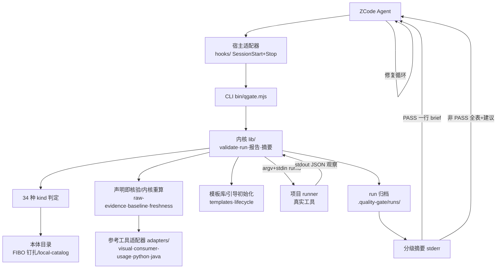

# Universal Delivery Gate Framework for ZCode
## 面向 Code Agent 的可裁剪软件交付质量门禁框架设计与研发指南（演进基线 v0.9）

> **实施状态补注（2026-10-08）**：v2.0 终审已完成本文所采用范围；§52 四轨道完成条件、OD-101–107 与后续范围裁定逐项对账见 [FINAL-REVIEW-2.0.0](../history/FINAL-REVIEW-2.0.0.md)。AsyncAPI 经本轮用户裁定纳入 3.0 JSON 子集；原始观察记录保持显式启用。原 Draft 描述、提案和未勾选框作为 2026-09-30 设计输入保留，不再代表当前未完成项；生产工具/第二适配器等未采用候选不计入完成声明。
>
> 文档状态：Draft v0.9（全量演进基线，取代 v0.1 作为后续开发的指导基线；v0.1 归档为原始设计基线，不再更新）
> 实现基线：v1.16.0（2026-09-30；34 种 gate kind、464 项回归[463 过/1 skip]、37 个示例、配置 schemaVersion 0.2）
> 新增维度：Agent 对齐失效防护（意图漂移 / 上下文遗忘 / 技术幻觉 / 范围蔓延）
> 设计原则：小步构建、小步验证、证据驱动、可裁剪、可替换、可演进（自 v0.1 不变）
> 日期：2026-09-30
>
> **提案概念声明**：本文 §39–§45 与 §47 引入的新概念均为**提案态**（按 GLOSSARY §1 提案概念例外行文），正式登记发生在对应能力立项实施时。提案概念清单：任务意图登记（task intent register）、漂移对账（drift check）、AC 结构化协议（首选 Gherkin，2026-09-30 裁决；EARS 为对照素材）、约定登记（convention register）、约定对齐（convention alignment）、符号存在性对账（symbol grounding）、API 存在性协议、trace 贯通核验、回放资产。
>
> **与活文档的分工**：本文是设计指导基线（上下文层），回答"系统应该是什么样、为什么、往哪走"；产品需求与路线在 [PRD](../PRD.md)，需求→实现→证据的单一索引在 [RTM](../RTM.md)，现行配置与 runner 协议规范在 [GATE-SPEC-v1.19](../GATE-SPEC-v1.23.md) 与 [CONFIG-GUIDE](../CONFIG-GUIDE.md)，架构决策在 [adr/](../adr/)。本文对现状的描述以 v1.16.0 为实现基线，若与活文档冲突，以活文档为准。

---

# 0. 文档目的

本文档是 v0.1 原始设计基线的全量演进版，用于指导下一阶段的研发工作。

v0.1 回答的问题是：

> 如何建立一套可以被机器执行、可以被 Agent 消费、可以逐步收集证据、可以暴露未知风险、最终能够解释"为什么一个软件版本基本具备交付条件"的机制？

v1.0–v1.16 已经把这个问题落成了可部署的现实：六域 34 种 kind、Claim → Evidence → Gate → Risk → Exception 证明链、Stop 阻断反馈回路、引导初始化与配置生命周期、声明即核验与内核重算的证据纪律链。

v0.9 在此之上补一个 v0.1 没有正面回答的问题：

> **当 Code Agent 本身就是对齐失效的高发源时，门禁体系如何防护"过程对齐"？**

四类典型对齐失效——意图漂移、上下文遗忘、技术幻觉、范围蔓延——发生在制品生成过程之中。它们多数无法靠"跑更多测试"发现，因为 agent 自己写的测试可能共享同一个漂移（自证循环）。v0.9 的任务是把"对齐"从不可见的过程属性，变成**可声明、可核验、可阻断**的门禁对象。

本文档既描述方法论，也固化当前实现的事实基线，并给出对齐防护四轨道的设计与阶段路线。它遵循与 v0.1 相同的写作纪律：每提出一项能力，必须同时回答要解决的问题、最小实现、可观察输出、自动验证方式与故意不支持什么。

---

# 1. 背景与问题定义

## 1.1 Vibe Coding / Agentic Coding 的交付质量问题（自 v0.1 保留）

Code Agent 显著提高了编码速度，但"代码生成速度"与"软件可交付性"并不是同一个问题。Agent 很容易生成：局部正确整体错误的代码、编译通过但跨模块契约错误的代码、测试与实现共享同一错误假设的代码、功能主路径正确但状态机与异常分支错误的代码、业务概念映射错误但传统测试全过的代码、完成了代码却遗漏验收条件与运维资料的交付。

传统 lint → build → unit → E2E 流水线只检查"实现制品"，不回答：Agent 是否完整理解了需求？是否存在未经确认的假设？代码、接口、Schema、持久化是否描述同一个业务事实？Agent 自己生成的测试是否形成自证循环？当前版本为什么可以被认为具备交付条件？

因此本项目构建的不是"更多测试"，而是 Software Delivery Assurance System——软件交付可信证明系统。这一目标与六域模型、五对象元模型在 v1.0–v1.16 已经落地，本文不再重述推导过程（见 v0.1 §1 与 PRD §1）。

## 1.2 对齐失效：v0.9 新增的问题维度

在交付可信问题之下，vibe coding 的日常实践中还有一层**过程性**的对齐失效。四类典型失效、表现与根因：

| 失效类型 | 典型表现 | 根因 |
|---|---|---|
| 意图漂移（intent drift） | 每次迭代生成结果合理，但累积偏离用户最初目标 | Chat 上下文只保留最近若干轮，早期约束被"挤出"窗口 |
| 上下文遗忘（context loss） | 新 session 不记得 200 行之前的代码约定 | LLM 训练后权重冻结，session 之间无状态 |
| 技术幻觉（hallucination） | 引入不存在的 API、调用未声明的函数 | LLM 用统计合理性填补知识空缺 |
| 范围蔓延（scope creep） | "顺带"重构、改名、加未要求功能 | Agent 试图"显得有帮助" |

四类失效的共同结构：**根因在模型与交互机制，不在某一处代码缺陷**。这意味着：

1. 不能靠单点修复消除，只能靠**结构性载体**约束（把意图/约定/存在性/范围显式化为可核验对象）；
2. 失效在多轮之间累积（漂移）或跨会话重现（遗忘），单次检查时机不够，需要**贯穿任务生命周期的对账**；
3. agent 的自述不可信（"我没有偏离目标"不构成证据），必须由**内核独立核验**。

## 1.3 两类问题的关系

交付可信证明与对齐防护是正交互补的两件事：

```text
交付可信证明（已有）：制品是否达到交付条件？
对齐失效防护（v0.9 新增）：制品的生成过程是否一直对着正确的靶子？
```

如果过程漂了，制品证明再严密，证明的也是"偏了的东西"。反过来，只有对齐没有证明，也无法回答"为什么可交付"。所以对齐防护不是替代或削弱六域门禁，而是给六域门禁补上**靶子本身的核验**：L0 的需求追踪之所以可能名存实亡，正是因为任务级意图没有结构化载体可对照；L1 的静态检查协议之所以接不住幻觉，正是因为"符号存在性"从未成为对账对象。

治理路径也与本项目的既有哲学一致：不是"让 LLM 更聪明地自我检查"，而是把对齐失效暴露为**缺少证据的 FAIL**——没有意图基准的"完成"是自述，没有对账的引用是悬空，没有登记的约定是空文。

---

# 2. 项目目标

## 2.1 最终目标（自 v0.1 不变）

构建一个**智能体平台无关、可声明、可组合、可裁剪、可追踪、可独立验证的软件交付质量门禁框架**，并首先实现为可部署、可实际使用的 ZCode 插件。未来同一内核可以通过适配器挂载到其他 Code Agent、IDE、CI。

在此之上，v0.9 补充对齐子目标：

> 让"任务意图、仓库约定、符号存在性、变更范围"四类对齐事实，都拥有与 Claim/Evidence/Gate 同构的可声明载体与可核验判定。

## 2.2 当前已达成（v0.1 阶段 0–9 的实绩）

v0.1 的 MVP 十项闭环（安装 → Hook 触发 → 声明 → 执行 → 证据 → 判定 → 阻断 → 反馈 → 修复 → 自动化测试）自 v0.1 起达成并持续回归。v1.0–v1.16 的主线依次落地：六域 34 kind、F2P/P2P 双向测试协议、支付数据正确性、信任边界收敛（W1–W5）、拓扑语义（R1–R4）、原始证据内核解析链（B1 → C3 → C2：unit rawOutput → behavior/journey 观察记录 → baseline 内容绑定与两源一致）、消费者链层（consumer-matrix）、Stop 摩擦优化（新鲜度复用、new-only 降级、会话基准）、统一语言治理（GLOSSARY + ADR-0016 + 弃用词防回归）。逐版证据见 RTM 与 docs/release/。

## 2.3 v0.9 阶段目标：对齐防护四轨道闭环

以任务意图轨道为例，最小闭环必须满足：

1. 任务开始时意图可被结构化登记（问询不代写）；
2. 任务过程中的变更可相对意图基准对账（漂移可见、指名）；
3. 超出意图范围的变更构成 FAIL 并进入 Stop 阻断反馈；
4. 修复或显式修订意图后可重新 PASS；
5. 整个流程有可运行正例、故意失败反例与自动化测试。

约定对齐、符号存在性、验收可观测三轨道同构（各自的最小闭环见 §47）。四轨道全部落地后，§1.2 的四类失效中：范围蔓延与意图漂移获得任务级判定；上下文遗忘获得约定对账判定；技术幻觉获得存在性对账判定；验收可观测补齐 trace 贯通与回放资产。

---

# 3. 非目标

v0.1 的非目标全部继续有效：不做通用形式化验证器、不证明"绝对无 Bug"、不宣称 ISO 26262 合规、不把 FIBO 写死进核心、不让 LLM 自由决定结论、不以"LLM 说没问题"作为 PASS 证据、不把所有门禁每次编辑都执行一遍、不做企业级 SaaS 与 Web 控制台。

v0.9 新增以下明确不做：

- **不做自然语言意图理解**：意图登记与 AC 结构化协议只做结构对账与结构校验，不判定"这段话是不是用户的真实意图"——意图与登记的一致性靠人在回路确认（问询不代写）；
- **不让 agent 代写任务意图登记**：与引导初始化同纪律，agent 只问询与建议，写入只发生在用户确认之后；
- **不核验约定文件全文语义**：AGENTS.md / constitution / 术语表只对账其中被结构化的条目，不做 markdown 语义理解；
- **不把 EARS/Gherkin 做成可执行 DSL 引擎**：AC 结构化协议 + 与测试案例的联动建议，不是 BDD 框架；
- **不内置 APM 或 trace 收集**：trace 贯通核验是声明式对账协议，生产 OpenTelemetry 接入属各项目工程；
- **不做编辑器内联拦截**：PreToolUse 只做范围标记与软提示，阻断仍只发生在门禁判定处；
- **不做 sub-agent 编排**：多智能体协作是宿主/平台职责，本框架只保证任何来源的变更面对同一套门禁。

历史范围决定重申（不因 v0.9 回潮）：发布包签名（in-toto/DSSE）与仓库自有 CI 已出项目范围（2026-09-26）；R13 拓扑推导器与容器编排接入已永久出项目范围（2026-09-27，topology 门禁保持纯声明核验）；1.8.0 裁剪项（migration/operational/readiness 门禁、scan 的 dependency/secret/iac/dast 类别、metrics 证据纪律、releasePackage/priorRuns）不重新列入路线。

---

# 4. 核心设计原则

v0.1 的八条原则全部保留，并附上 v1.0–v1.16 的现实化注记；随后新增三条对齐原则。

## 4.1 Evidence First（不变）

Gate 的本质不是"运行命令"，而是**为某个 Claim 收集足够 Evidence，并根据 Policy 作出准入判定**。

## 4.2 No Evidence ≠ PASS（不变）

检查未执行、工具不存在、环境不具备、数据无法读取——一律不得记 PASS。现实实现：这些情况落入 ERROR（fail-closed，见 §20 的有意偏差记录），SKIP 明确不算通过。

## 4.3 Deterministic First, LLM Second（不变）

确定性规则 > 可执行测试 > 结构化模型检查 > LLM 推理。LLM 可以发现候选风险、辅助转写（提案-确认工作流），不单独决定放行。v0.9 的对齐轨道延续此序：AC 结构化协议做结构校验而非语义理解、约定对齐做条目对账而非文档理解、符号存在性做静态对账而非猜测。

## 4.4 Incremental Verification（不变）

只检查受影响的东西。现实实现：stages 裁剪（edit/close/pr/release）、Stop 新鲜度复用、inspect 的变更影响驱动附加门禁建议块。

## 4.5 Independence of Evidence（保留，注记演进）

v0.1 设想为 Evidence 标注来源与独立性。现实实现走了另一条更硬的路：**不信任 runner 自报**——声明即核验（内核解析原始证据重算交叉核验）、证据信号（六个内核可独立核验的信号）、强度等级（核验级 > 声明级 > 降级）、降级标注（弱来源显式可见）。R8"独立性字段"仍暂缓，当前以信号/等级/降级三层承担同等治理职责。

## 4.6 Ontology as Provider（不变）

本体语义经 Provider 接口供给，核心框架只认识 Concept / Relation / Constraint / Invariant / Term / Semantic Finding。现实实现：FIBO 固定版本钉扎目录（52 类）+ local-catalog 替换。

## 4.7 Agent Platform Independence（不变）

Kernel + CLI 协议 + 宿主适配器。现实实现：内核与 ZCode 无关，Hook、Command、Skill 触发同一个 CLI。

## 4.8 Small Step, Verified Step（不变）

每增加一项能力都必须定义：要解决的问题、最小实现、可观察输出、自动验证方式、回归测试、是否达到阶段准出条件。

## 4.9 意图显式化（Intent Explicitness，v0.9 新增）

任务的范围、验收条件与约束，在任务开始时结构化落盘。**没有意图基准的"完成"只是 agent 自述**。意图基准一经确认即被守护（自引用哈希），修订必须显式、留痕、可追责。

## 4.10 约定即门禁（Convention as Gate，v0.9 新增）

仓库约定——统一语言、弃用词、命名、结构规则——必须能退化为**可执行的对账条目**。只写在 markdown 里、靠 agent 自觉遵守的约定，在新会话开始的那一刻就等于没有约定。约定的结构化登记是门禁的一等输入，而不是文档的装饰。

## 4.11 引入即对账（Introduce-and-Reconcile，v0.9 新增）

变更中每一个**新增引用**——import、API 调用、领域概念——都必须能对账到一个已存在的声明面：依赖清单、契约、术语表、本体目录或项目内模块。**"看起来合理"不是存在性证据**。这与 F2P/P2P 防伪修复互补：F2P/P2P 管"修复是不是真的"，引入即对账管"引用是不是真的"。

---

# 5. 三个观察视角

v0.1 定义了两个正交维度。v0.9 增加第三个视角（不是新的层，而是同一批 kind 的重新分组方式）。

## 5.1 维度 A：质量域（不变）

```text
L0 范围、需求与生成完整性
L1 代码与工程正确性
L2 接口、数据与系统一致性
L3 功能与业务语义正确性
L4 架构、非功能与安全
L5 交付、运行与治理完整性
```

## 5.2 维度 B：Agent 生命周期（现状 + 候选扩展）

现实实现的执行阶段：

```text
edit（编辑后快速检查）
close（任务收尾，Stop Hook 阻断点）
pr（提交/评审）
release（发布）
```

v0.9 候选扩展（设计态，见 §30 与轨道 A）：**task-start（任务开始）**——意图登记与约定注入的时机；**before-change（变更前）**——PreToolUse 范围标记的时机。二者先以宿主 Hook 软形态存在，不新增内核 stage 枚举（避免配置协议膨胀，判定时机仍归 close/pr/release）。

## 5.3 维度 C（新增）：对齐失效视角

四类失效横切六个域。同一批 kind 按 C 视角重新分组：

| 失效类型 | 现有最强覆盖 | 主要缺口 | v0.9 轨道 |
|---|---|---|---|
| 意图漂移 | traceability（项目级 AC 对账 + prdRef 绑定）、F2P/P2P（伪修复防护） | 任务级意图无结构化载体；多轮累积漂移无对账基准；AC 为自由文本无结构 | 轨道 A（§41） |
| 上下文遗忘 | GLOSSARY 统一语言 + terminology 门禁（本体术语）、SessionStart 会话基准注入 | 仓库约定文件（AGENTS.md 等）自身不被核验；弃用词防回归只是本仓库自有测试；ADR 与 decisions 登记脱节 | 轨道 B（§42） |
| 技术幻觉 | semantic-alignment（本体 IRI 存在性）、consumer-matrix（契约内使用面）、engineering static（项目自接工具） | v0.1 §7.1 列出的 undefined symbol 从未实现；import/依赖对账无内核能力；API 存在性无协议 | 轨道 C（§43） |
| 范围蔓延 | change-scope（allowed/protected 路径、R-source 改名跟踪、selfGuard、pinnedBase、contentCheck）——四类中覆盖最强 | 变更级路径判定不接任务意图；不判语义变更（既有边界） | 轨道 A 增量（§41.4） |

这张表是 v0.9 的需求来源：后文的轨道设计逐行对应缺口列，工具方法对照见 §40。

---

# 6. L0–L5 质量域：34 种 kind 的现状总览

状态图例沿用 RTM：**原生**＝内核有专门验证与结构化证据；**协议**＝原生执行协议（内核跑真实工具、按结构化结果判定，分析逻辑由项目配置）；**部分**＝部分原生（覆盖面有明确边界）。

| 层级 | kind 数 | kind 清单（状态） |
|---|---:|---|
| L0 范围、需求与生成完整性 | 4 | traceability（原生）、assumptions（原生）、decisions（原生）、change-scope（原生） |
| L1 代码与工程正确性 | 2 | engineering（协议）、command（协议） |
| L2 接口、数据与系统一致性 | 7 | persistence（原生）、alignment（部分）、consumer-matrix（原生）、consistency（原生）、invariant（原生，L2/L3 两属）、ontology-map（原生，目录存在性核验）、semantic-profile（部分，SHACL Core 词汇对齐） |
| L3 功能与业务语义正确性 | 12 | journey（协议）、visual（部分）、property（协议）、behavior（部分）、terminology（原生）、semantic-alignment（部分）、semantic-relation（原生）、semantic-constraint（原生）、semantic-state（原生）、semantic-instance（原生）、semantic-exposure（原生）、semantic-consistency（原生） |
| L4 架构、非功能与安全 | 6 | scan（协议，三类）、metrics（部分，纯阈值）、resilience（部分）、budget（原生，纯内核算术）、topology（原生，R1–R4）、rerun（原生，同 seed 双次运行核验） |
| L5 交付、运行与治理完整性 | 3 | configuration（原生）、documentation（部分）、debt（原生） |

对齐视角的增量不新增层级：轨道 A 主要落在 L0，轨道 B 落在 L0/L5，轨道 C 落在 L1/L2，轨道 D 落在 L3/L4。

---

# 7. L0：范围、需求与生成完整性

核心问题（不变）：**Agent 是否做了完整且正确范围内的事情？**

当前实现（v0.1 子项 L0.1–L0.5 全部承载）：

| v0.1 子项 | kind | 检查语义（现状） |
|---|---|---|
| L0.1 需求追踪 | traceability | requirements 登记文件逐条 AC 关联 codeFiles 与 testGateIds（同轮 PASS 门禁证据，元门禁除外）；AC 类型覆盖 normal/boundary/negative/exception/state-transition（逐需求 requiredTypes 或门禁级 defaultRequiredTypes）；可选 prdRef 结构化绑定 PRD 文件（requirePrdRefs 强制）；可选 coverage runner 按 AC 核验链接代码是否被执行 |
| L0.3 假设登记 | assumptions | 每条假设须处理（open/rejected 即 FAIL）；空登记须显式 none:true（空登记直通阻断）；可选 requireProvenance 强制结构化来源/证据引用（{file}/{gateId} 声明即核验） |
| L0.4 Open Decision | decisions | 决策登记 resolved/open/deferred；deferred 必带 revisitBy 期限；可选 requireProvenance；affectsPaths/affectsGateIds 影响链接；L5 阶段必须关闭 |
| L0.5 变更范围 | change-scope | Git 基准（baseRef，可 pinnedBase 钉扎 commit）上的 A/M/D/R 变更集对账 allowed/required/protected 路径；R/C 变更源路径（R-source/C-source）一并入变更集；受保护路径确认可绑定 acknowledgedBase（基准移动后失效）；spec 自引用守护 selfGuard；可选 contentCheck 内容级检查与 requireContentCheck 强制 |

对齐视角新增（轨道 A，§41）：**任务级意图载体**。现状的两个基准——PRD/RTM（项目级、长期）与 git 基准（变更级、即时）——之间缺一层：**本次任务用户到底要什么**。没有这一层，L0.1 的"有实现、有证据"与 L0.5 的"没超路径"都可能成立于一个已经漂离原始意图的任务。

---

# 8. L1：代码与工程正确性

核心问题（不变）：**代码作为工程制品是否成立？**

当前实现：

| v0.1 子项 | kind/子检查 | 检查语义（现状） |
|---|---|---|
| L1.1 静态检查 | engineering static | 协议层：项目经 argv 接入 lint/type 工具，内核按结构化观察判定；逐 finding 按严重度阈值 |
| L1.2 构建 | engineering build | 协议层：非空制品 + SHA256 |
| L1.3 单测 | engineering unit | 协议层：计数核验；blockOnSkipped、minTotal、minCoverageRatio（coverage 证据交叉核验）；F2P/P2P 双向协议（防伪修复）；rawOutput 声明即核验（TAP/JUnit 内核重算）；baselineRawOutput 基线侧内核重算；baselineSource 内容绑定 |
| L1.4 变异测试 | engineering mutation | 协议层：killed/total/score + 存活明细 |
| L1.5 结构规则 | engineering structure | 协议层：逐 finding 分严重度；生产依赖图工具由项目接入 |
| L1.6 仓库约定 | engineering convention | 协议层：项目自配 runner |
| （通用） | command | argv 退出码门禁，任何工具的最小接入形态 |

对齐视角新增（轨道 C，§43）：v0.1 §7.1 列出的 **undefined symbol / dead code 检查从未实现**——static 子检查完全依赖项目自接工具，"agent 引入了不存在的 API"这一最高频的幻觉形态在框架层没有兜底。轨道 C 把**符号存在性对账**（import 对账内核原生 + API 存在性声明即核验协议）补进 L1/L2。

---

# 9. L2：接口、数据与系统一致性

核心问题（不变）：**系统不同部分是否描述同一个事实？**

当前实现：

| v0.1 子项 | kind | 检查语义（现状） |
|---|---|---|
| L2.1 API 契约对齐 | alignment | 声明契约 vs 运行观察，JSON Pointer 差异，ignorePaths；contract-diff 模式承接契约兼容阻断（compatibilityLevel + oasdiff 类 breaking 观察）；mode live/static + requireLive；sourceFingerprint 声明即核验 |
| L2.1 消费者链层 | consumer-matrix | 逐消费者期望文件 vs provider 契约观察 → 兼容矩阵 + 破坏归因；使用面三来源（scanned/contract-test/declared），越界使用 FAIL；Pact 产物归一与多语言静态扫描参考工具 |
| L2.2 Schema 结构对齐 | alignment | 迁移后实际列结构 vs 声明（示例走 SQLite）；ORM/外键/多方言留项目边界 |
| L2.3 Schema 语义检查 | semantic-profile | SHACL Core 词汇对齐的 profile 规则，非完整 SHACL 引擎 |
| L2.4 持久化行为验证 | persistence | 真实调用后**独立回读**逐字段核对（ADR-0013）；requireSnapshots 默认强制（前后快照 + delta）；expectedRecordCount 批量协议 |
| L2.5 跨表不变量 | invariant / consistency | invariant：eq/neq/le/lt/ge/gt + when 条件；consistency：支付数据正确性五类（zero-sum、append-only、reconciliation、dlq、audit-chain 内核重算哈希链） |
| （本体映射） | ontology-map | 配置映射 IRI 在钉扎目录中存在性核验 |

对齐视角新增（轨道 C）：consumer-matrix 已经把"消费者不得使用契约之外的字段"做成判定（越界使用）；轨道 C 把同一思想前移到**编码时刻的引用面**——import 必须对账依赖清单/项目内模块，API 引用必须对账声明面。L2 与 L1 的轨道 C 增量是同一原则（引入即对账）在两个层面的应用。

---

# 10. L3：功能与业务语义正确性

核心问题（不变）：**系统实际做的事情是否符合业务世界？**

当前实现：

| v0.1 子项 | kind | 检查语义（现状） |
|---|---|---|
| L3.1–L3.3 旅程 | journey | smoke/integration/e2e 场景逐步骤预期；ignorePaths 豁免易变字段；rawTranscript 声明即核验（观察记录 runId 绑定、逐步骤交叉核验） |
| L3.4 视觉 | visual | 字节级比较为默认，可选像素容差（runner 回报 diff 度量、内核阈值判定）；参考浏览器 runner（系统 Chrome/Edge headless CLI） |
| L3.5 PRD 行为验证 | behavior | 案例输入/预期，内核判 F2P/P2P 基线（runner 无法自判）；rawTranscript + baseline 块两源一致核验 |
| L3.6 领域不变量 | property | 固定 seed、多案例、金额断言、允许状态转换（无穷举证明/自动收缩留边界） |
| L3.7 本体语义门 | terminology + semantic-* 八种 | 八层：IRI 对齐（semantic-alignment，含互斥传播/运行时来源/matchMode:subsumed/acknowledgedOntology 指纹）→ 术语（terminology，SKOS 完整性 + 项目术语解析）→ 关系（semantic-relation）→ 约束（semantic-constraint）→ 状态（semantic-state）→ 实例（semantic-instance）→ 暴露（semantic-exposure）→ 一致性（semantic-consistency，可选外部 reasoner 双实现一致性核对） |

对齐视角新增（轨道 D，§44）：L3 的证据链经 B1→C3→C2 三轮已经把"runner 自报"收敛到"内核重算"，但**跨服务的 trace 贯通**与**观察记录作为回归资产的系统化复用**仍是缺口。轨道 D 补前者（协议）、整理后者（资产化约定）。

---

# 11. L4：架构、非功能与安全

核心问题（不变）：**实现方式是否可接受？**

当前实现：

| v0.1 子项 | kind | 检查语义（现状） |
|---|---|---|
| L4.1 架构适应度 | metrics | 纯阈值判定（1..20 指标 min/max）；四原则拓扑正反例演示；canaryAnalysis 灰度判定协议承载于此 |
| L4.3 可观测性信号 | resilience | 故障演练必需信号 log/metric/trace/alert；requiredTransitions 熔断全路径；maxAgeDays 证据时效 |
| L4.4 扫描 | scan | 三类别：sast / api-authz（逐 operation 显式鉴权）/ credential（轮换与 vault 来源）；acceptedFindings 显式豁免 + 过期恢复阻断 |
| L4.6 故障恢复 | resilience / budget | resilience 演练协议；budget 纯内核超时/重试预算算术（jitter/backoff/预算守恒） |
| （拓扑语义） | topology | R1–R4 纯声明核验：故障域分布、副本阈值分型、一阶最小割集、role 对称/leader 轮转 |
| （确定性） | rerun | 同 seed 双次运行 sha256 一致 + 幂等键策略 + 复式恒等式 |

裁剪史实（不回潮，见 §3）：L4.2 非功能阈值专属能力、L4.5 DAST、scan 的 dependency/secret/iac 类别已随 1.8.0 移除。

对齐视角新增（轨道 D）：resilience 已核验**信号存在性**，未核验**贯通性**——trace_id 是否真的跨服务传播。轨道 D 的 trace 贯通核验协议补此缺口，仍属声明式协议（不做 APM）。

---

# 12. L5：交付、运行与治理完整性

核心问题（不变）：**是否能部署、运营和追责？**

当前实现：

| v0.1 子项 | kind | 检查语义（现状） |
|---|---|---|
| L5.1 配置核对 | configuration | 多环境配置对比：缺键、类型冲突、未声明差异（allowedDifferences 路径模式）、明文秘密脱敏 |
| L5.3 文档一致性 | documentation | 制品登记：角色/路径/期望版本/主题；内核核验存在且非空 |
| L5.5 技术债登记 | debt | owner/影响/期限；逾期与高严重度阻断；空登记须显式 none:true；resolved 项证据引用核验 |
| L5.6 决策收尾 | decisions | L5 阶段 open/deferred 均 FAIL（收尾判定） |

裁剪史实（不回潮）：L5.2 迁移演练、L5.4 运维就绪、L5.7 发布证据包（releasePackage/priorRuns）已随 1.8.0 移除；单次运行报告仍含完整证据与 configSha256。

对齐视角新增（轨道 B，§42）：**决策登记与 ADR 文档的双向绑定**——现状 decisions 门禁核验自有登记文件，而项目真正的决策史往往在 docs/adr/*.md 里，两处脱节正是上下文遗忘的典型土壤。轨道 B 用 ADR frontmatter 机器可读协议把两者接起来。

---

# 13. 核心 Assurance Meta-model

框架的核心不是 Test，而是五个对象（自 v0.1 不变）：

```text
Claim   —— 我们希望证明什么
Evidence —— 支持或反驳 Claim 的可追溯事实
Gate    —— 根据证据与策略作出的准入判定
Risk    —— 无法充分证明时的显式暴露
Exception —— 对风险或失败的显式、可过期接受
```

辅助对象：

```text
Artifact —— 证据所指向的制品（代码/契约/SQL/本体/登记文件/runbook/配置）
Run     —— 一次门禁执行上下文与全部判定归档
```

v0.9 的元模型扩展评估结论（详见 §45）：**不新增顶层对象**。任务意图、约定条目、ADR frontmatter 都是 Artifact（登记文件），对它们的判定仍由 Gate 产出 Evidence；对齐失效的暴露仍走 Risk/Exception。这是有意克制：元模型稳定是六年来 34 种 kind 共存的基础。

---

# 14. Claim

Claim 表示**我们希望证明的可验证陈述**。现实实现为 `.quality-gate.json` 顶层 `claims[]`：

```jsonc
{
  "claims": [
    { "id": "G-TESTS", "statement": "全量回归套件在并发钳制下通过（463 过/1 skip）" }
  ]
}
```

门禁经 `claimId` 绑定声明。推荐字段（statement 之外的来源/criticality 等）在 v0.1 中设想为结构化字段，现实实现保持最小形状——来源与强度由 Evidence 侧的证据信号与强度等级表达（§15），避免声明侧重复建模。

---

# 15. Evidence

Evidence 表示**支持或反驳 Claim 的可追溯事实**。现实实现为 run 报告内逐门禁 `evidence[]` 条目：

```jsonc
{
  "id": "<uuid>",
  "gateId": "G-TESTS",
  "claimId": "G-TESTS",
  "kind": "engineering",
  "level": "L1",
  "startedAt": "…", "finishedAt": "…",
  "status": "PASS",
  "details": { "…kind 专属结构化观察…" }
}
```

v0.1 为 Evidence 设想的 producer/independence 字段未引入（R8 暂缓），独立性治理由三层现实机制承担：

1. **证据信号（六种）**：git 基线核验、来源指纹、双次运行一致、持久化快照、原始输出解析、基线内容核验——全部是内核可独立核验的标记；
2. **强度等级（三级）**：核验级 > 声明级 > 降级——由实测信号推导，无信号不显示（不虚报）；
3. **降级标注**：弱来源（embedded 基线、static 观察、declared 使用面来源、显式降级登记）在报告"证据降级"行可见。

支撑这三层的核心模式是**声明即核验**与**内核重算**：runner 声明原始证据文件（TAP/JUnit/观察记录/基线内容），内核解析、自行重算并与自报交叉核验，判定以内核值为准。B1（unit rawOutput）→ C3（behavior/journey 观察记录）→ C2（基线内容绑定与两源一致）三轮同构收尾后，残余风险收敛为"不可信 runner 可对真实内容伪造两份一致记录"——这一残余如实声明，不做无限信任升级。

---

# 16. Gate

Gate 表示**根据一组声明、证据要求与策略作出的准入判定**。因此 `Gate != shell command`——一个 Gate 可以是纯内核文件式判定（budget/topology/rerun/terminology 等），也可以是协议形态（内核跑真实工具、按结构化观察判定）。

现实配置形状（`.quality-gate.json` 顶层 `gates[]`，1..32 个）：

```jsonc
{
  "id": "G-TESTS",
  "kind": "engineering",
  "level": "L1",
  "enabled": true,
  "stages": ["close", "pr"],
  "claimId": "G-TESTS",
  "…": "kind 专属字段（argv/file/登记引用等）"
}
```

裁剪三轴：`enabled`（开/关）、`stages`（时机）、`requiredLevels`（阶段必需层级）。每阶段执行预算 ≤40 秒，单 argv 超时 1..40000 毫秒。

---

# 17. Risk

当 Claim 无法被充分证明，或出现潜在暴露时生成 Risk。现实实现为顶层 `risks[]`（`{id, gateId, description}`），作为显式登记与例外挂载点。机制评审的敞口清单实践（W1–W5、C 系、B 系）证明：**暴露不确定性比隐藏它更接近真相**——这仍是框架对 Risk 的一贯立场。

---

# 18. Exception

Exception 是对某个风险或门禁失败的显式接受。现实形状（顶层 `exceptions[]`，≤20 个）：

```jsonc
{
  "id": "EX-1", "gateId": "…", "riskId": "…",
  "reason": "…", "owner": "…", "expiresAt": "2026-12-31",
  "status": "approved", "approvedBy": "…", "approvedAt": "…"
}
```

纪律（自 v0.1 严格化）：提议即阻断；已审批且在有效期内呈现 **WAIVED**（单独列示、计入例外台账、**不改变任何门禁判定**——豁免从不把 FAIL 变 PASS）；过期或未生效自动回退阻断。审批是声明字段，无签名防伪造（签名已出项目范围）。

---

# 19. Artifact 与 Run

**Artifact**：声明类输入集中于项目 `.quality-gate/registries/`（requirements/assumptions/decisions/debt 等登记文件，可提交）；运行数据在 `.quality-gate/runs/`（gitignore 仅忽略 runs/）。

**Run**：单次运行全部判定与证据归档于 `.quality-gate/runs/<uuid>.json`，schemaVersion 0.2，顶层含 `claims/risks/exceptions/evidence[]、status、configSha256、levelCoverage、unmetRequiredLevels` 等。configSha256 是配置指纹：Stop 复用归档结论、会话基准绑定、new-only 降级判定都以它为一致性前提。

---

# 20. Gate 判定状态（现实版与有意偏差）

现实状态集：

```text
PASS   —— 所需证据充分且核验一致（退出码 0）
FAIL   —— 证据明确反驳声明（退出码 1）
ERROR  —— 框架/配置/runner 层故障，fail-closed（退出码 2）
SKIP   —— 门禁不在本阶段执行（退出码 2，SKIP 不算 PASS）
```

与 v0.1 的三处有意偏差（RTM X2 记录在案）：

1. **INCONCLUSIVE 归入 ERROR**：v0.1 设想的"证据不足"独立状态未引入——现实实现一律 fail-closed 落 ERROR，宁可多阻断不静默放行；"灰度判定 inconclusive 不计 PASS"是 canaryAnalysis 协议内的判定值，不是门禁状态；
2. **WAIVED 限定为呈现语义**：只在已审批例外上呈现，不构成门禁状态、不改变判定；
3. **NOT_APPLICABLE 未引入**：不适用以 `enabled:false` 或 stages 裁剪在配置层表达，不进入判定。

---

# 21. Gate 状态机（现实版）



PASS 不是终态：Stop Hook 的复用判定要求"同阶段 + configSha256 一致 + 其后声明输入无 mtime 变更"，任一不满足即重跑（新鲜度 fail-safe，无法判定一律重跑）。

---

# 22. Agent 生命周期映射

现实默认矩阵（stages × 层级；✓=模板/常见配置启用）：

| 层级 | edit | close | pr | release |
|---|---|---|---|---|
| L0 | | ✓ | ✓ | ✓ |
| L1 | ✓ | ✓ | ✓ | ✓ |
| L2 | 选择性 | ✓ | ✓ | ✓ |
| L3 | 选择性 | ✓ | ✓ | ✓ |
| L4 | | 选择性 | ✓ | ✓ |
| L5 | | 选择性 | 选择性 | ✓ |

Stop Hook（close 阶段阻断点）现状：归档结论新鲜时直接复用；可选 `stop.blockMode:"new-only"` 把会话前既有且声明输入未变的 FAIL 降级为警告（ERROR、未声明 inputs、配置漂移仍阻断；只影响呈现，不改判定与退出码）；项目无配置与宿主适配器自身错误不阻断。

v0.9 候选扩展（设计态）：**task-start 时机**（意图登记/约定注入，经 UserPromptSubmit 软形态）与 **before-change 时机**（PreToolUse 范围标记）——见 §30.7。二者不新增内核 stage 枚举，判定仍归 close/pr/release，避免"每次提示词都跑门禁"的摩擦回归。

---

# 23. 总体架构



要点（相对 v0.1 §23 的现实化）：

1. v0.1 设想的 Executor Runtime 八类（Static/Build/Test/DB/API/Security/Ontology/LLM）现实收敛为**一种协议**：argv runner + stdin runId + stdout JSON 观察——HTTP/SQLite/扫描等差异全部留在 runner 侧，内核只认观察协议。这使 34 种 kind 共享同一信任模型；
2. **LLM Reasoner 未进内核**（v0.1 OD-005 的既定答案）：LLM 参与只发生在两个安全的缝隙——提案-确认工作流（ontology-proposals.json，confidence 不构成证据）与提示词层（SKILL/命令），判定零依赖 LLM；
3. **内核重算链**（B1 → C3 → C2）是架构的信任脊柱：unit rawOutput → behavior/journey 观察记录 → 基线内容绑定与两源一致，三轮同构，逐层把"runner 自报"换成"内核重算"。

---

# 24. 三层产品结构

```text
Kernel（lib/：34 种 kind 判定 + 证明链元模型 + 观察/核验协议）
Capability Packs（kind + 模板 + 附加门禁）
Agent Adapters（hooks/ 宿主适配器 + adapters/ 参考工具适配器）
```

v0.1 设想的独立 `gate-packs/` 目录未出现——能力包在现实中以**kind + 引导模板 + 附加门禁项**的组合承载：一种新检查能力 = 一个 kind 判定器 + templates.mjs 里的模板/附加门禁登记 + CONFIG-GUIDE 样例 + examples 演示。这个承载方式更轻，且与"新增可配置项必须同步 CONFIG-GUIDE（测试强制）"的纪律咬合。v0.9 的轨道能力沿用此结构，不另立包形态。

宿主适配器保持单一（ZCode）；第二适配器之前先固定核心-宿主事件协议（既有候选，见 §53）。

---

# 25. 声明式配置与裁剪

项目配置 `.quality-gate.json`（schemaVersion 0.2）顶层：`claims / gates / risks / exceptions / requiredLevels / stop / template / ontology`。协议键迁移纪律：旧键（如 v1.16 的 domain 族）fail-closed 拒绝并指名迁移，归档 run 报告经读兼容垫片继续可渲染。

裁剪的现实形态（v0.1 §26 Profile 设想的落地）：

```text
档位（tier）：lite ⊂ pro ⊂ max
模板（7 个）：minimal / node-engineering / web-api / ledger-service /
             security-hardened / six-domain / release-governed
附加门禁（6 项）：change-scope / sast-scan / api-authz-scan /
                 credential-scan / debt-register / rerun-evidence
```

配置生命周期分权（ADR-0014/0015）：

- **首运行**：`/quality-gate-init` 引导对话（agent 只问询不代写）→ `qgate init` 确定性装配（占位符残留即拒绝）；
- **重初始化**：`qgate leftovers` 列残留 → 确认后 `init --fresh`；
- **升级/增量**：`qgate inspect`（有效性/预算/模板漂移/登记存在性 + 变更影响驱动的附加门禁建议块）→ `qgate update`（changes 契约增量 + 登记文件迁移）；
- 登记文件集中于 `.quality-gate/registries/`（可提交），运行数据在 `.quality-gate/runs/`。

v0.9 对齐轨道的新能力一律按此结构入位：新 kind → 可选模板登记 → 附加门禁项（带 suggest 元数据，供 inspect 建议块推荐）→ CONFIG-GUIDE 同步。

---

# 26. Impact Analysis

v0.1 §27 设想的"Change → Affected Claims → Applicable Gates"完整影响图未实现（X3 后续如实记录）。现实已落地的三个增量形态：

1. **stages 裁剪**：配置声明每门禁的执行时机（静态影响面）；
2. **新鲜度复用**（v1.14）：同阶段 + configSha256 一致 + 声明输入无 mtime 变更时，Stop 直接复用归档结论不重跑（性能优化非证明，fail-safe 回退重跑）；
3. **变更影响驱动建议**（v1.15）：`qgate inspect` 以附加门禁库 suggest 元数据（路径模式）× `git status --porcelain -uall` 未提交变更面计算建议块——建议性输出不代写配置。

轨道 A 落地后，影响分析多一个输入源：**任务意图声明的 scope**（§41.4——意图 scope 与变更面的交集/差集即"任务内变更/越界变更"），这是对 v0.1 设想的"Affected Gates"最接近的一次落地，但形态是登记对账而非依赖图推导，边界如实。

---

# 27. Runner 协议

统一观察协议（所有 argv 型 kind 共享）：

```text
内核 spawnSync(argv, {shell:false})，当前用户权限
stdin  → 当次 runId（UUID，内核生成）
stdout → 相同 runId 的 JSON 观察
约束   → 缺失/过期/格式错误/超时/非零退出 均不得 PASS
$NODE  → 替换为插件当前 Node 可执行文件
```

观察协议族（按 kind 组合）：

| 协议块 | 用途 | 信任形态 |
|---|---|---|
| 基础观察 | 结果/计数/findings 自报 | 内核形状校验 |
| baselineSource（git 型 file+contentSha256） | F2P/P2P 基线来源 | 内核 `git show` 内容比对（证据信号：基线内容核验） |
| rawOutput（TAP/JUnit） | 单测原始输出 | 内核解析重算计数（声明即核验） |
| rawTranscript（qgate-transcript） | behavior/journey 逐用例观察记录 | runId 绑定防重放 + 逐例交叉核验 |
| baselineRawOutput | 基线实现原始输出 | 内核逐用例重算基线状态 |
| sourceFingerprint | 观察绑定具体制品 | 磁盘哈希声明即核验 |
| contentCheck / coverage | 变更内容级检查 / AC 覆盖 | finding 是否接受由配置决定，runner 无权自判放行 |

外部依赖登记（KNOWN_TOOLS）：`git`、`python/python3/py`、`chrome/msedge`——运行前仅 `--version` 预检，缺失时报告/SessionStart/摘要注入安装指引（X10 纪律：缺工具必须提示，不得静默降级）。

---

# 28. 证据归一化与证据力

归一化：不同工具结果统一为 kind 专属 `details` 结构化观察（内核不依赖具体工具格式），报告摘要层按 kind 提取失败原因。

证据力（只读聚合，不改判定）：每次运行的摘要对 **PASS 门禁**汇总证据信号（六种）与定量信号（测试计数、覆盖率、变异分数、性质/行为用例数），推导强度等级：

```text
核验级 —— 存在内核可独立核验的证据信号
声明级 —— 仅 runner 自报数值（形状经内核校验）
降级   —— 存在证据降级声明（优先级最高）
```

无信号不显示（不虚报）。这一层回答了 v0.1 §31"Evidence Independence"的展示问题：不是给证据打可信分，而是**只统计内核亲手核验过的事实**。

---

# 29. ZCode Plugin 集成

插件构成（`.zcode-plugin/plugin.json` 登记）：

```text
plugins/quality-gate/
├── hooks/hooks.json          # SessionStart + Stop（仅两个）
├── commands/                 # /quality-gate、/quality-gate-init、/quality-gate-update
├── skills/quality-gate/      # 门禁执行纪律的提示词层
├── bin/qgate.mjs             # CLI（run/report/proposals/templates/init/update/inspect/leftovers）
├── bin/ontology.mjs          # 本体目录 CLI
├── lib/                      # 内核（34 kind + 协议 + 模板 + 摘要）
├── adapters/                 # 参考工具适配器（visual/consumer-usage/python/java）
├── examples/                 # 37 个演示（examples.manifest.json 单一事实源）
└── tests/                    # 464 项回归
```

分发与升级：本地 marketplace（directory 型）+ `sync_client_marketplace.py` 快照同步 → 客户端"更新"按钮（只读快照不读源仓库）。实机验收与 CLI/模拟测试分别记录（LIVE-ACCEPTANCE 系列与 evidence/）。

v0.1 §32 列举的 Plugin 能力中，**Subagent 与 MCP Server 未使用**：MCP 结构化工具面（gate.plan/gate.run/…）仍是内核稳定后的候选（§31）。

---

# 30. Hook 职责

## 30.1 SessionStart（现状）

注入：质量约束提示（含分级报告以 Markdown 正文呈现的纪律）、缺配置项目的引导初始化指向、缺失外部依赖安装指引、最近一次 close 通过运行的**会话基准**（配置哈希 + 逐门禁结论，绑定本会话）与 mtime 新鲜度括注、失败门禁清单。不执行昂贵门禁。

## 30.2 Stop（现状，核心阻断点）

无配置项目不阻断 → 归档结论新鲜则复用 → 否则执行 close 阶段门禁 → PASS 静默放行；非 PASS 以 `decision:block` 回传全量摘要表（状态/层级覆盖/逐门禁原因/建议列），客户端重试上限内驱动修复循环。`stop.blockMode:"new-only"`：会话前既有且声明输入未变的 FAIL 降级为警告呈现。

## 30.3–30.6 v0.1 设想的其余 Hook（现状对照）

- **UserPromptSubmit**（v0.1 §34.2）：未使用 → 轨道 A 设计态启用（§30.7）；
- **PreToolUse**（v0.1 §34.3：scope guard 设想）：未使用 → 轨道 A 设计态启用（§30.7）；
- **PostToolUse / PostToolUseFailure**（v0.1 §34.4/34.5：收集变更/快速门禁）：未使用——edit 阶段门禁已覆盖"修改后快速检查"需求，Hook 层重复收集的收益不抵协议复杂度，维持不做（边界如实，非遗漏）。

## 30.7 对齐扩展（v0.9 设计态，轨道 A 配套）

**UserPromptSubmit（意图捕获）**：检测开发任务开始的信号（首条任务型提示词），注入提示要求 agent 引导用户完成任务意图登记（问询不代写）；已登记且未确认修订时，注入当前意图基准一行（scope 摘要），让"最初约束"在每个新会话可见——这是对"早期约束被挤出窗口"的结构性对抗。不阻断、不跑门禁。

**PreToolUse（范围守卫）**：对 Write/Edit 类工具调用，若目标路径不在任务意图声明的 scope 内，注入 systemMessage 提示"该路径超出本次任务声明范围"——**软提示非拦截**（拦截会造成不可预期的编辑中断；真正的判定与阻断仍在 close 阶段 change-scope 对账）。不跑测试、不做权限决策。

两个 Hook 都属于宿主适配器层，内核零依赖：即使不启用，任务意图登记与漂移对账仍可完全经 close 阶段门禁工作（Hook 只是把失效暴露提前到发生时刻，降低修复成本）。

---

# 31. Command / Skill / MCP

- **Commands**（3 个）：`/quality-gate`（运行与报告纪律）、`/quality-gate-init`（引导初始化问询，agent 不代写）、`/quality-gate-update`（增量调整问询，含附加门禁建议预选）。对齐轨道落地时按需增补（候选：`/quality-gate-intent` 任务意图登记引导，OD-105 关联）；
- **Skill**：提示词层，承担"如何在本项目按门禁纪律完成开发闭环"的执行约定（先识别需求、显式记录假设、失败优先修复、不把 SKIP 当 PASS、分级报告贴正文）。轨道 A/B 落地需同步扩展：意图登记流程、约定登记维护纪律；
- **MCP**：维持 v0.1 §37 的判断——先证明 Kernel 有效，再增加 Agent 工具面。结构化工具（gate.status/evidence/risks）仍是第二适配器之后的候选，不在 v0.9 路线内。

---

# 32. CLI

CLI 是基础接口（调试、CI、独立测试、不被宿主生命周期绑死）。现实子命令：

| 子命令 | 用途 |
|---|---|
| `qgate run <root> [stage]` | 执行门禁（close 为 Stop 阻断同款） |
| `qgate report <root> [runId]` | 重渲染归档运行（runId 唯一前缀，歧义 fail-closed） |
| `qgate templates [tier]` | 模板库与附加门禁清单（含 ontologyHint） |
| `qgate init <root> <answers>` | 确定性装配写入（--force/--fresh） |
| `qgate update <root> <changes>` | changes 契约增量应用 + 登记迁移 |
| `qgate inspect <root>` | 有效性/预算/漂移/登记存在性 + 附加门禁建议块 |
| `qgate leftovers <root>` | 重初始化残留扫描 |
| `qgate proposals` | 本体映射提案审计（accepted-not-pinned 漂移） |
| `ontology.mjs` | 本体目录检查/升级工作流 |

轨道能力的新 CLI 面（提案，随轨道实施定稿）：任务意图登记的校验/展示子命令（如 `qgate intent <root>` 只读渲染当前任务基准与漂移对账结果——形态属 OD-101）。

---

# 33. Ontology 架构

现状（v0.1 §39–§44 设想的落地与边界）：

- **Provider 可替换**：FIBO 钉扎目录（Agreements/Contracts 两模块 52 类，逐源 SHA 核验、运行不联网、随包分发）或 local-catalog 项目目录；
- **推理能力**：内建 OWL 子集——`subClassOf` 传递闭包、`disjointWith` 沿继承传播（A⊥B 且 D⊆B ⇒ A⊥D）、RDFS 子集 matchMode:subsumed；**不是完整 OWL/SHACL 引擎**（semantic-profile 与 SHACL Core 词汇对齐但非 SHACL 实现；semantic-consistency 可选外部 reasoner 双实现一致性核对——内核不采信外部单独声称的结论）；
- **八层语义门禁**：IRI 对齐 → 术语 → 关系 → 约束 → 状态 → 实例 → 暴露 → 一致性；
- **人在回路的映射维护**：提案-确认-pin 工作流（LLM/匹配工具提案 → 人工接受 → pin），confidence 不构成证据；
- **目录升级**：acknowledgedOntology 指纹确认（升级后不符即 FAIL），ontology_diff.py 分类加法/破坏性变更。

后续候选（C6）：完整 OWL/SHACL、多语言术语、双人核准——维持候选，不在 v0.9 路线。

---

# 34. Persistence Verification

L2 最值得优先实现的判断（v0.1 §45）已被验证：persistence 门禁是六域中原生程度最高的 kind 之一。核心纪律（ADR-0013）：**runner 调用 API 后，必须以独立回读（新会话/新连接）取回持久化结果**——不复用写入路径的对象；requireSnapshots 默认强制（before/after 快照 + delta 入证据，退出须显式 false）；批量协议 expectedRecordCount 与快照互斥。

场景声明形状（延续 v0.1 §45 的场景式设计，现实为 kind 专属字段）：

```text
setup（前置数据）→ execute（真实调用）→ assert.response
                → assert.persistence（逐字段期望）
                → assert.invariants（跨表/跨服务断言）
```

---

# 35. Gate Policy 与证据时效

- **预算**：每阶段总预算 ≤40 秒、单 argv 超时 1..40000 毫秒、门禁 ≤32 个——多门禁项目必须裁剪或分阶段；
- **时效**：证据不永久有效。现实机制按门禁覆盖：resilience `maxAgeDays`（演练观察过期即 FAIL）、acknowledgedOntology 指纹（目录升级失效）、acceptedFindings `expiresAt`（豁免过期自动恢复阻断）、Stop 新鲜度（输入 mtime 变更即重跑）；
- **缓存**：run 归档 + configSha256 + 新鲜度构成缓存键的等价物；未实现 v0.1 §49 设想的输入哈希缓存（收益不抵复杂度，如实记录）。

---

# 36. 安全边界

- argv 以当前用户权限执行（与构建脚本同等审查）；不自动执行未知脚本，command executor 面向项目显式配置；
- 秘密脱敏失败（configuration 门禁发现明文秘密即 FAIL 并脱敏呈现）；数据库连接配置不进证据；
- 报告只落本地（`.quality-gate/runs/`），不外传；
- 本体目录不获得生产权限；演示用扫描器/本地故障演练不得表述为生产认证（证明边界纪律）。

---

# 37. Evidence Store 与项目配置

```text
<project>/
├── .quality-gate.json          # 门禁配置（init/update 写入，人不可手改通道）
└── .quality-gate/
    ├── registries/             # 声明类登记文件（可提交）
    │   ├── requirements.json   #   需求与 AC（traceability）
    │   ├── assumptions.json    #   假设登记
    │   ├── decisions.json      #   决策登记
    │   ├── debt.json           #   技术债登记
    │   └── …（kind 专属登记，轨道 A/B 新增者同置于此）
    └── runs/                   # 运行数据（gitignore）
        └── <uuid>.json         #   单次运行归档（证据与判定唯一来源）
```

v0.1 §51 设想的 SQLite 证据库未采用（OD-002 的既定答案）：JSON 归档 + 读兼容垫片已满足可追溯与可重渲染，对象模型稳定前不引入第二存储。

---

# 38. 仓库结构与技术选择

```text
quality-gate/
├── plugins/quality-gate/       # 插件+内核+CLI+Gate+测试+示例（持续研发主位置）
├── docs/                       # 五层文档（产品/规范/状态/历史/上下文）
├── evidence/                   # 各阶段回归、正反例与实机证据
├── acceptance/                 # 实机/CLI 复验项目与夹具
├── devtools/                   # 打包/同步/套件包装器脚本
├── dist/                       # 历史安装包与 SHA256
└── marketplace.json            # 本地 marketplace 入口
```

技术选择（自 v0.1 §54 收敛）：Node.js 20+、**零 npm 依赖**（运行不联网；原始证据解析全部自研纯函数）、跨平台（Windows/macOS/Linux）。内核 API 避免绑定 Node 专属语义的意图部分实现——Python/Java 参考工具适配器以子进程协议接入，替代了"多语言 Executor"设想。

---

# 39. 对齐失效与门禁映射总表

§5.3 给出了概览，本节给出可执行的对照细节——每一行即一条设计依据。

## 39.1 意图漂移

- **失效机理**：早期约束被"挤出"上下文窗口后，agent 的每一步仍局部合理，但靶子已经换了。测试可能全绿——因为测试是 agent 按漂移后的理解写的（自证循环）。
- **现有覆盖**：traceability 把 PRD 级 AC 与代码/测试对账（项目级、静态）；F2F/P2P 防"伪修复"（变更级、动态）；二者都不回答"本次任务从开始到现在，对的是同一个靶子吗"。
- **缺口**：任务意图无结构化载体；AC 自由文本无结构（机器无法区分"可验证的验收条件"与"愿景陈述"）；多轮之间无对账基准。
- **轨道**：A（§41）。

## 39.2 上下文遗忘

- **失效机理**：session 之间无状态。上个会话建立的术语约定、架构决定、弃用称谓，新会话一概不知，除非它被写进文件**且新会话被强制对齐**。
- **现有覆盖**：GLOSSARY 统一语言（本仓库治理实践）+ terminology 门禁（本体术语歧义）+ SessionStart 会话基准（质量状态注入）+ documentation（制品存在性）。
- **缺口**：约定文件（AGENTS.md / CLAUDE.md / constitution）自身不被核验——弃用词防回归目前只是本仓库的自有测试（tests/glossary.test.mjs），未插件化为门禁能力；决策登记（decisions 门禁）与决策文档（docs/adr/*.md）双轨脱节。
- **轨道**：B（§42）。

## 39.3 技术幻觉

- **失效机理**：LLM 以统计合理性填补知识空缺——生成"看起来该存在"的 API 名、函数签名、配置键。局部语法正确，运行/构建时才炸，或者更糟：被 agent 顺手"修好"（再引入一层幻觉）。
- **现有覆盖**：semantic-alignment 核验本体 IRI 存在性（仅限已声明映射的符号）；consumer-matrix 核验消费者使用面不越契约（provider 契约内）；engineering static 全靠项目自接工具（协议空白态）。
- **缺口**：v0.1 §7.1 明列的 undefined symbol 检查从未实现；import/依赖对账无内核能力；API 存在性无声明即核验协议。
- **轨道**：C（§43）。

## 39.4 范围蔓延

- **失效机理**：agent 试图"显得有帮助"——顺带重构、改名、加未要求功能。单次看每处都"更好"，累积看交付物与需求无关变更混杂，评审成本和回归风险同时上升。
- **现有覆盖**（四类中覆盖最强）：change-scope 以 git 基准对账 allowed/required/protected 路径；R-source/C-source 让改名挪移不绕过确认；selfGuard/pinnedBase 防配置与基准被静默移动；contentCheck/requireContentCheck 覆盖内容级检查；`qgate inspect` 建议块按变更面推荐附加门禁。
- **缺口**：变更级路径判定不接任务意图——"项目允许改这个路径"与"本任务应该改这个路径"是两回事；语义变更不判（既有边界，维持）。
- **轨道**：A 增量（§41.4——意图 scope 派生会话级范围集）。

---

# 40. 阶段工具方法对照与纳入判定

需求/设计/编码/测试/验收各阶段的常用对齐工具方法，逐项判定（已覆盖 = 现有 kind 承载；纳入 = 进入 v0.9 轨道；不纳入 = 记入非目标或维持既有候选）：

| 阶段 | 工具/方法 | 判定 | 承载/说明 |
|---|---|---|---|
| 需求 | EARS 五模板 | **纳入（轨道 A）** | AC 结构化协议：结构校验 + 与 requiredTypes 映射，不做语义理解 |
| 需求 | Gherkin | OD 备选 | 与 EARS 二选一或双支持（OD-102）；不做成 BDD 执行引擎 |
| 需求 | User Story + 结构化 AC | 已覆盖（增强） | requirements 登记的 AC type/requiredTypes/defaultRequiredTypes |
| 需求 | User Story Mapping | 不纳入 | 过程管理方法，无机器判定对象（非目标） |
| 设计 | ADR（MADR/Nygard + frontmatter） | **纳入（轨道 B）** | frontmatter 机器可读 + decisions 登记双向绑定 |
| 设计 | OpenAPI / AsyncAPI | OpenAPI 已覆盖；AsyncAPI 维持候选 | alignment contract-diff 与 consumer-matrix 已以 OpenAPI 归一；事件契约场景未开 |
| 设计 | JSON Schema | 已覆盖（形态） | 观察 JSON 协议 + 内核代码侧校验（未采用独立 schema 文件，见 §27） |
| 设计 | constitution.md | **纳入（轨道 B 载体）** | 作为约定登记的可选来源文件之一，条目化后对账 |
| 设计 | design.md | 不单独纳入 | documentation 已核制品；设计↔代码偏差由语义轨道与约定登记按需承载 |
| 编码 | AGENTS.md / CLAUDE.md / .cursorrules | **纳入（轨道 B）** | 约定登记的来源文件；条目结构化后内核对账 |
| 编码 | Plan Mode / PLAN.md | **纳入（轨道 A 输入）** | 任务意图登记可引用 plan 产物作为 scope/AC 来源 |
| 编码 | Sub-agents | 不纳入 | 宿主/平台职责（非目标） |
| 编码 | Agent Hooks | 已覆盖 + 扩展 | SessionStart/Stop 已用；UserPromptSubmit/PreToolUse 轨道 A 设计态（§30.7） |
| 测试 | 契约测试（Pact/Dredd） | 已覆盖 | consumer-matrix + Pact 产物归一 + 多语言扫描（参考工具适配器） |
| 测试 | TDD（Red-Green-Refactor） | 已覆盖 | F2P/P2P 即 TDD 的证明协议（基线须败 + 当前须过） |
| 测试 | Property-based（Hypothesis） | 已覆盖 | property kind（固定 seed 多案例；自动收缩维持候选） |
| 测试 | Mutation testing | 已覆盖 | engineering mutation 子检查 |
| 验收 | Acceptance-driven review（人在回路） | 已覆盖 | 例外审批协议 + 引导对话问询纪律；双人核准维持 C6 候选 |
| 验收 | AI 生成验收报告 | 已覆盖 | 分级摘要 + 证据力行 + run 归档（报告即证据台账） |
| 验收 | E2E 录制与回放 | 部分已覆盖 → **纳入（轨道 D）** | rawTranscript 已是录制；回放资产化（replayBaseline）为轨道 D 增量 |
| 验收 | OpenTelemetry + trace_id 贯通 | **纳入（轨道 D）** | trace 贯通核验协议（声明式）；生产 OTel 接入属项目工程 |

---

# 41. 轨道 A：任务意图（提案）

> 提案概念：任务意图登记（task intent register）、AC 结构化协议、漂移对账（drift check）。

## 41.1 问题与现有基础

三层基准缺中间层：

```text
PRD / RTM      —— 项目级、长期（做了什么产品）
（缺）          —— 任务级、一个任务周期（本次用户要什么）
git 基准        —— 变更级、即时（这次改了哪些文件）
```

没有中间层时，"任务完成"的可信判定只剩 agent 自述与项目级静态对账；意图漂移在整个任务周期内不可见，直到交付物与用户期望的落差大到测试之外。

## 41.2 任务意图登记（task intent register）

载体（提案，OD-101 定稿）：`.quality-gate/registries/task-intent.json`，与既有登记文件同置：

```jsonc
{
  "taskId": "refund-cap",
  "statement": "为退款增加可退余额上限校验",
  "scope": ["src/payment/**", "tests/payment/**"],
  "acceptance": [
    { "text": "When 退款金额超过可退余额, the system shall 拒绝并返回 REFUND_EXCEEDED",
      "type": "negative", "format": "ears" }
  ],
  "constraints": ["不引入新依赖", "不改公共 API 契约"],
  "source": { "kind": "user-prompt", "ref": "会话首轮（登记性，不回读对话）" },
  "createdAt": "2026-10-08T09:00:00Z",
  "confirmedBy": "user"
}
```

纪律：

1. **问询不代写**：登记由 `/quality-gate-intent` 类引导对话（或 UserPromptSubmit 注入提示）问询产出，agent 提案、用户确认，写入走确定性通道（对齐 init 的 CLI 装配纪律）；
2. **确认留痕**：`confirmedBy` 与 `createdAt` 是人在回路的证据；意图登记与用户真实意图的一致性**只由确认动作背书**，框架不判语义；
3. **修订显式**：意图修订 = 新版本 + 修订理由，旧版本哈希留在 run 归档中——多轮"温水煮蛙"式的 scope 扩张在修订链上可见、可审计；
4. **自引用守护**：沿用 selfGuard 思想——change-scope 配置可登记意图文件内容哈希，意图文件被静默篡改即可检测；
5. **生命周期**：一个活跃意图对应一个任务；close 阶段门禁 PASS 后随 run 归档引用（哈希入证据）；新任务须新登记或显式修订。

## 41.3 AC 结构化协议

> 格式裁决（2026-09-30）：AC 结构化**首选格式经用户裁决为 Gherkin**（见 §53 OD-102——生态成熟/团队熟悉度高/与旅程步骤天然对齐；代价=与 requiredTypes 类型覆盖映射较弱、易写成多步骤剧本，实施时须配 Gherkin→AC 类型映射约定）。本节 EARS 设计保留为 AC 结构化协议的对照素材与双支持备选；Gherkin 的 AC 结构化协议设计随"A 剩余"轮展开（v1.17 组合轮不含 AC 结构化协议）。

AC 的结构问题：自由文本 AC 无法区分"可验证的验收条件"与"愿景陈述"。EARS（Easy Approach to Requirements Syntax）五模板是对症的结构化答案——它本来就是为"可验证、无歧义的原子需求"设计的：

```text
无处不在的    The <system> shall <response>
事件驱动      When <trigger>, the <system> shall <response>
状态驱动      While <state>, the <system> shall <response>
不需要行为    If <condition>, then the <system> shall <response>
可选特征      Where <feature included>, the <system> shall <response>
```

协议（提案）：traceability 与任务意图登记的 AC 均可选声明 `format:"ears"`，内核做**结构校验**——五模板的触发词结构 + 系统主语 + 响应动词的最小骨架，不判语义。中文等价模板词表（当…时/在…期间/如果…则/其中…/应当）随实施定稿（OD-102）。

与既有协议的联动：

- **requiredTypes 映射**（建议性）：事件驱动→normal、不需要行为（If…then 拒绝/降级）→negative/exception、状态驱动→state-transition、可选特征→按特性归类——结构即类型证据，defaultRequiredTypes 的覆盖检查更有据；
- **案例联动**（建议性）：EARS 的 trigger/state 天然是 behavior/property 用例的输入构造来源（When 条件→用例前置，shall 响应→期望）——首版做"联动建议"（报告提示未覆盖的 EARS AC），不做自动生成；
- **转写工作流**：自然语言 AC → EARS AC 由 LLM 提案、人确认（复用本体映射的提案-确认-pin 纪律，提案文件不入判定）。

## 41.4 漂移对账（drift check）

change-scope 增强（不加新 kind，判定语义同源）：

1. **意图 scope 对账**：配置可选 `taskIntent:{file}` 绑定意图登记。变更集对账从"项目 allowed 集"升级为"项目 allowed 集 ∩/∪ 任务 scope"（集成策略 OD-107）；超出任务 scope 的变更 FAIL 指名 `outside-task-scope`（越界文件清单入证据）——"顺带改了别处"从路径级直接暴露；
2. **约束对账**（首版一条可判定约束）：`constraints` 中声明式 `no-new-dependencies` 对账依赖清单 diff（与轨道 C 的 import 对账共享数据）；其余约束（如"不改公共 API"）登记性呈现，由 alignment contract-diff / consumer-matrix 等既有门禁自然承载——不重复造判定；
3. **累积漂移可见**：意图登记在任务周期内不变（修订显式），因此**每一轮 close 都相对同一原始意图对账**——累积漂移不再依赖记忆，依赖登记；
4. **意图基准守护**：意图文件哈希入证据；pinnedBase 绑定任务起始 commit，二者合成"从哪出发、要干什么"的完整基准。

## 41.5 证据与判定

- 新增失败原因：`outside-task-scope`（越界文件清单）、`intent-file-modified`（意图文件静默变更）、`ac-structure-invalid`（AC 结构不合模板，指名条目）；
- Stop 阻断语义不变：FAIL 进入既有阻断反馈循环，agent 收到"超任务范围文件 X/Y/Z，请还原或显式修订意图"的可操作反馈；
- 意图登记的存在本身可配置为必需（`requireTaskIntent:true` 时无登记即 FAIL——没有意图基准的"完成"是自述）。

## 41.6 示例场景（demo-intent-drift，提案）

场景驱动（仿 change-scope-demo 的临时 Git 项目模式）：

```text
正例：scope 内变更 + EARS 合法 AC        → PASS
反例1：顺带修改 scope 外文件            → FAIL 指名 outside-task-scope
反例2：AC 缺触发词/响应动词             → FAIL 指名 ac-structure-invalid
反例3：意图文件被静默修改               → FAIL 指名 intent-file-modified
恢复：还原越界文件 / 修订意图（显式+理由）→ PASS，修订链留痕
```

## 41.7 边界（故意不支持）

- 不判语义：scope 是路径级，"改了范围内文件但改错内容"由 F2P/P2P、behavior 等既有门禁承载；
- 不验证用户真实意图：登记与真实意图的一致性靠确认留痕（人在回路），框架只守护"登记后不被静默漂移"；
- 不做对话回读：`source` 是登记性引用，不解析会话记录（宿主数据边界）；
- 宽 scope 确认的治理依赖修订链可见性——框架提供审计面，不替用户做判断。

---

# 42. 轨道 B：约定对齐（提案）

> 提案概念：约定登记（convention register）、约定对齐（convention alignment）。

## 42.1 问题与现有基础

统一语言治理（v1.16）在本仓库证明了一件事：**弃用词防回归测试上线当天就逮住了清扫漏网与新写文档的禁词**——约定一旦可机器核验，就持续生效。但这套能力目前是本仓库的自有测试（tests/glossary.test.mjs），不是插件的门禁能力；任何其他项目想获得同等约束，只能手写测试。同时，AGENTS.md/constitution 里的约定条目对 agent 是"提示词级"的——遵守与否无判定。

## 42.2 约定登记（convention register）

载体：`.quality-gate/registries/conventions.json`：

```jsonc
{
  "rules": [
    {
      "id": "TERM-no-deprecated",
      "type": "banned-words",
      "words": ["旧称谓甲", "旧称谓乙"],
      "scope": ["docs/**/*.md", "src/**"],
      "exemptions": [{ "pattern": "历史称谓", "marker": "盘点" }],
      "severity": "fail",
      "source": { "file": "AGENTS.md", "section": "术语约定" }
    },
    {
      "id": "CONV-import-style",
      "type": "argv",
      "argv": ["$NODE", "scripts/check-import-style.mjs"],
      "timeoutMs": 5000
    }
  ]
}
```

- **规则类型首版两种**：`banned-words`（内核原生扫描）与 `argv`（项目自配 runner，复用统一观察协议）。不做语义类规则（不核验 markdown 全文理解）；
- **banned-words 内建规则族**：零依赖逐文件逐行扫描，机制直接泛化本仓库 glossary 测试的成熟实践——映射记法豁免（"旧→新"对照行）、行内白名单标记、前后缀跳过、义项拆分；中英词、同义词组、severity 阈值可配；
- **溯源字段**：每条规则 `source` 绑定其来源约定文件与章节——约定的"文档形态"与"可执行形态"双向可追；
- **转写工作流**：AGENTS.md/constitution.md 中的可机器检查条目 → 约定登记条目，由 LLM 提案、人确认（提案文件不入判定；无法退化为确定性规则的条目如实留在提示词层，不硬造规则）。

## 42.3 承载形态（OD-103）

提案为**新 kind `convention-alignment`**（L0）：与 engineering convention 子检查的差别在判定语义——前者是"登记条目 ↔ 制品对账"（原生、零 runner 依赖），后者是"项目工具执行协议"（分析逻辑在 runner）。二者并存不冲突：convention-alignment 管"仓库自己声明的约定"，engineering convention 管"生态工具的检查结果"。

本仓库自举：轨道 B 实施时评估把 tests/glossary.test.mjs 的弃用词扫描迁移为 convention-alignment 配置（迁移后原测试保留结构校验部分或整体退役，届时裁决并记录——自举是本轨道最好的第一个验收项目）。

## 42.4 ADR frontmatter 机器可读绑定

decisions 门禁增强（提案）：

- **协议**：ADR 文件头可选 YAML frontmatter（MADR/Nygard 兼容字段）：`status: proposed|accepted|deprecated|superseded`、`date`、`deciders`、`supersedes`、`superseded-by`；
- **绑定**：decisions 登记条目新增可选 `adrRef:{file}`——声明即核验：文件存在性 + 防逃逸 + frontmatter 解析；
- **状态对账**：登记状态 ↔ ADR status 映射核验（open↔proposed、resolved↔accepted、deferred↔deferred 且须 revisitBy），不一致 FAIL 指名；`supersedes/superseded-by` 链与登记修订关系交叉核验；
- **可选强制**：`requireAdrRefs:true`（项目走 ADR 驱动开发时，每个决策须绑定 ADR）。

价值：决策史从"两处平行记录"（登记文件 + ADR 目录）变为"一处事实一处索引"——新会话读 ADR 拿到的决策状态，与门禁判定的决策状态，由协议保证一致。

## 42.5 证据与边界

- 证据：逐规则命中清单（文件/行/词或规则 finding）、豁免命中、扫描范围统计、ADR 状态对账表；
- 边界：只对账结构化条目，不做约定文件全文语义核验；条目转写质量靠确认留痕；豁免机制可被滥用（`exemptions` 逐条须 reason，审计面呈现）。

---

# 43. 轨道 C：符号存在性（提案）

> 提案概念：符号存在性对账（symbol grounding）、API 存在性协议。

## 43.1 问题与现有基础

幻觉的最高频形态是"引用了不存在的东西"。现有三块能力各管一段：semantic-alignment 管"本体概念存在性"（需先有映射声明）、consumer-matrix 管"契约内使用面"（provider 契约视角）、engineering static 是协议空白（项目不接工具就什么都没有）。**从"agent 在变更里写下一个 import"到"构建爆炸"之间，框架层没有任何兜底**——这正是 v0.1 §7.1 列出 undefined symbol 却从未实现的缺口。

## 43.2 import 对账（内核原生，JS/TS 首版）

原则：**引入即对账**（§4.11）。设计（提案）：

- **输入**：变更集（复用 change-scope 的 git diff）中的 `.js/.mjs/.cjs/.ts/.mts` 文件，或全量（`check:"changed-files"|"all"` 可配，默认 changed-files——存量问题不拦新账）；
- **提取**：保守词法提取 import/require/from 说明符（静态字符串说明符；模板字符串/变量拼接等动态形态**明确不覆盖并如实标注**）；
- **对账目标三分类**（Node 解析算法子集）：项目内模块（相对路径 + 扩展名补全 + index 解析）、依赖清单（package.json dependencies/devDependencies，含 exports 子集）、内置模块（node: 前缀与核心模块枚举）；
- **判定**：说明符三分类全部不可解析 → FAIL 指名 `unresolved-import`（文件 + 说明符 + 尝试的解析路径入证据）；
- **零依赖纪律**：解析器自研纯函数（先例：TAP/JUnit/观察记录解析全部自研），不引语言服务。

语言范围（OD-104）：JS/TS 内核原生；Python/Java 走参考工具适配器——Python 侧由 runner 以真实解释器探测 import（pip 包名与模块名不同构，探测才是真对账；venv 边界如实），Java 侧对账依赖清单与源码 import（surefire 先例）；内核对参考适配器回报按声明即核验纪律核验。

## 43.3 API/符号存在性协议（协议层）

对超出 import 粒度的引用（方法、端点、配置键、类型成员）：

- **观察协议**：runner（类型检查器/语言服务器/契约校验器，项目自选）回报"变更中新增引用的符号/端点集"，每项带出处（file:line）；
- **声明面**：内核对账到项目声明的存在性依据——OpenAPI（端点）、类型声明文件（符号）、本体目录（概念，衔接 semantic-alignment）、配置 schema（配置键）；
- **声明即核验**：内核核验出处与声明面一致；runner 无权自判"存在"；
- **判定**：引用在所有声明面中不存在 → FAIL 指名 `unresolved-reference`。

## 43.4 与 F2P/P2P 的互补

```text
F2P/P2P        —— 修复是不是真的（行为方向证明）
符号存在性对账  —— 引用是不是真的（存在性证明）
```
二者合计把"agent 声称完成"的两类虚构成 false-fix 与 phantom-reference——分别闭环。

## 43.5 边界（故意不支持）

- 静态对账证明"引用可解析"，**不证语义正确**（参数类型对不对、版本兼不兼容、是否已废弃由类型检查器/扫描器承载）；
- 动态引用（拼接路径、运行时 require 变量）不覆盖，报告如实标注提取覆盖率；
- 不做跨包版本仲裁（依赖版本冲突走 dependency 工具，已裁剪类别不回潮）。

---

# 44. 轨道 D：验收可观测（提案）

> 提案概念：trace 贯通核验、回放资产（replay asset）。

## 44.1 trace 贯通核验协议

现状缺口：resilience 核验信号**存在性**（log/metric/trace/alert 各有没有），不核验**贯通性**——跨服务调用链的 trace_id 是否真的从入口传播到了每个下游。验收阶段"可观测性合格"的真相在贯通，不在存在。

协议（提案，resilience 增强，OD-106 定形态）：

- **观察**：演练 runner 回报跨服务调用的传播对清单 `{call, traceId, parentSpanId, childSpanId, traceparent?}`；
- **核验**（内核）：每个声明的调用对——child 与 parent 同 traceId；child 的 parentSpanId 与 parent 一致；（可选）traceparent 符合 W3C 传播格式；
- **判定**：断链（child 缺失、新开 traceId、id 不匹配）FAIL 指名调用对 `trace-discontinuity`；
- **边界**：核验的是 runner 回报的传播对，内核不采集流量、不做 APM；生产 OpenTelemetry 接入属各项目工程（KNOWN_TOOLS 纪律提示安装指引）。

## 44.2 观察记录复用为回放资产

现状：behavior/journey 的 rawTranscript 已是结构化逐用例/逐步骤录制（runId 绑定防重放——当次性是安全属性，也是资产属性：归档即录制）。轨道 D 把"录制→回放"的回路补上（提案）：

- journey/behavior 可选 `replayBaseline:{file}`：以某次归档观察记录为期望基线（类似 visual 的 pin 基线先例）；
- 当前执行逐步骤对照基线（步骤序 + 关键字段；易变字段走既有 ignorePaths）；
- 差异即**行为漂移证据**——"上次验收过的旅程这次走通了同样的路吗"从推断变成对账；
- 边界：行为回归对照，不是性能/时序回放；基线陈旧（需求变更后）须显式重 pin（复用 acknowledged* 确认思想）。

## 44.3 边界

轨道 D 整体优先级最低（生产工具接入属项目工程，本轨道交付的是协议与判定），但其协议形态与既有观察协议同构，实施成本低。

---

# 45. 元模型扩展评估

结论：**v0.9 不新增顶层元模型对象**。

| 对齐新载体 | 元模型归位 |
|---|---|
| 任务意图登记 | Artifact（登记文件）+ Gate（change-scope 增强）+ Evidence（对账结果与意图哈希） |
| AC 结构化协议 | traceability/意图登记内 AC 字段的结构约束 |
| 约定登记 | Artifact（登记文件）+ 新 kind（convention-alignment）+ Evidence |
| ADR frontmatter | decisions 登记的引用核验（{file} 族协议扩展） |
| 符号存在性 | engineering 增强 / 新 kind（实施定）+ 观察协议族新成员 |
| trace 贯通 / 回放资产 | resilience/journey/behavior 增强 |

对齐失效的暴露仍走既有通道：判定 FAIL 阻断、无法证明的显式 Risk、显式 Exception。克制的理由：元模型稳定是 34 种 kind 与四轮协议演进共存的基础；新对象必须有"五对象表达不了"的结构性理由，四轨道都不满足。

---

# 46. 已走路径摘要（v0.1 阶段设想的归宿）

| v0.1 设想阶段 | 现实归宿 |
|---|---|
| Phase 0 Hook Spike | 达成（v0.1 插件闭环，X8 十项闭环持续回归） |
| Phase 1 最小 Gate Kernel | 达成（command kind + validate/run/报告） |
| Phase 2 Agent Remediation Loop | 达成（Stop 阻断反馈循环 + 实机验收链） |
| Phase 3 Profile + Impact | 半达成：stages/模板/档位/附加门禁落地并引导化（v1.7 完整）；完整影响图未做，以新鲜度复用 + inspect 建议块承接 |
| Phase 4 Persistence Gate | 超额达成（ADR-0013 独立回读 + 快照默认强制 + 批量协议） |
| Phase 5 Claim/Risk/Exception | 达成（v1.6 审批窗口 WAIVED 呈现；审批为声明字段） |
| Phase 6 FIBO Provider Skeleton | 达成（钉扎目录 52 类 + local-catalog） |
| Phase 7 Ontology Semantic Gate v0 | 超额达成（八层语义门禁 + OWL 子集推理） |
| Phase 8 MCP | 未做（维持候选，判断不变） |
| Phase 9 扩展 Gate Pack | 达成（34 kinds；含 1.8.0 按用户决定裁剪） |

v0.1 未预见、由实际使用驱动的主线：信任边界收敛（W1–W5 → C 系 → B 系三轮内核重算链）、支付数据正确性（consistency 五类）、拓扑语义（R1–R4）、消费者链层（consumer-matrix）、Stop 摩擦优化（新鲜度/new-only/会话基准）、引导初始化与配置生命周期、统一语言治理。这段历史验证了 v0.1 §82 的判断：新增需求先判断归属阶段，原则上不跨阶段"顺手实现"——后续以 PLAN 的版本节奏承接。

---

# 47. v0.9 新阶段路线

四轨道各自成阶段，每阶段回答验收四问（v0.1 §66 纪律）。**版本号绑定显式留给 PLAN 与每轮选型节奏**——本文只定内容与依赖顺序。

## 阶段 A：任务意图（轨道 A）

| 四问 | 答案 |
|---|---|
| 加什么 | 任务意图登记（登记文件 + 问询引导）、AC 结构化协议、change-scope 漂移对账（outside-task-scope/意图守护/约束对账）、UserPromptSubmit/PreToolUse 软形态（宿主适配器层，可选启用） |
| 能证明什么 | "本次任务的变更全部落在声明的任务范围内；任务级 AC 具备可验证结构；意图基准自登记以来未被静默漂移" |
| 怎么验证 | demo-intent-drift 正反例（§41.6）+ 单元/集成测试 + 本仓库下一个真实开发任务自举试用 |
| 故意不支持 | 语义级意图判定、对话回读、自动 scope 推导（只建议不代写） |

依赖：无新协议依赖（复用 change-scope diff、登记文件、selfGuard 思想）。产出后轨道 C 的 no-new-dependencies 约束对账可挂接。

## 阶段 B：约定对齐（轨道 B）

| 四问 | 答案 |
|---|---|
| 加什么 | convention-alignment kind（banned-words 内建规则族 + argv 规则）、约定登记与转写工作流、decisions 的 adrRef frontmatter 绑定、本仓库 glossary 测试自举迁移 |
| 能证明什么 | "仓库声明的约定条目在指定范围内零违反；决策登记与 ADR 文档状态一致" |
| 怎么验证 | 正反例（违规词命中/豁免/ADR 状态错配）+ 自举：本仓库弃用词清单迁移后等效拦截 |
| 故意不支持 | 约定文件全文语义核验、自动规则生成（转写须人确认） |

依赖：无。可与阶段 A/C 并行开发，但建议在其后发布（自举迁移需要稳定的登记协议）。

## 阶段 C：符号存在性（轨道 C）

| 四问 | 答案 |
|---|---|
| 加什么 | import 对账（JS/TS 内核原生：提取+三分类解析+FAIL 指名）、API/符号存在性观察协议、Python/Java 参考工具适配器 |
| 能证明什么 | "变更中的每一个静态 import 都能对账到项目内模块/依赖清单/内置模块；新增引用符号经声明面核验存在" |
| 怎么验证 | demo（真实构造不存在模块/端点的正反例）+ 提取覆盖率边界测试（动态引用如实标注） |
| 故意不支持 | 语义正确性、版本仲裁、动态引用 |

依赖：变更集复用 change-scope；无新协议依赖。

## 阶段 D：验收可观测（轨道 D）

| 四问 | 答案 |
|---|---|
| 加什么 | resilience trace 贯通核验协议、journey/behavior replayBaseline 回放资产 |
| 能证明什么 | "演练中声明的每个跨服务调用 trace 贯通；当前旅程行为与已验收基线逐步骤一致" |
| 怎么验证 | 演练 demo（构造断链调用 FAIL）+ 回放 demo（基线漂移检出） |
| 故意不支持 | APM/流量采集、性能时序回放 |

依赖：观察协议族既有成员（rawTranscript）。

## 建议顺序与理由

**A → C → B → D**：A 缺口最大且零依赖（漂移是四类失效中最伤交付的）；C 独立且高频收益（幻觉每天发生）；B 涉及自举迁移宜在登记协议稳定后；D 协议同构、成本最低、优先级最低。顺序为建议，最终由每轮选型裁决。

选型记录（2026-09-30）：v1.17 经 AskUserQuestion 选定 **A 核心（任务意图登记+漂移对账，不含 AC 结构化协议与 Hook 软形态）+ C 首轮（import 对账，JS/TS）组合**——一轮覆盖两类失效优先于单轨完整；AC 结构化协议与 Hook 软形态随"A 剩余"留后续轮（Gherkin 首选已裁决，OD-102），API 存在性协议与 Python/Java 参考适配器随"C 剩余"留后续轮。执行规划见 PLAN.md v1.17 规划节；本轮未覆盖的轨道与顺序建议不变。

---

# 48. Golden Scenarios 扩展

既有演示族（demo-clean/故意失败反例族）之上新增（提案）：

```text
demo-intent-drift        —— 意图登记/越界变更/意图篡改/修订链（阶段 A）
demo-convention-align    —— 弃用词命中/豁免/ADR 状态错配（阶段 B）
demo-symbol-grounding    —— 不存在模块/不存在端点正反例（阶段 C）
demo-trace-continuity    —— 跨服务断链检出 + 回放基线漂移（阶段 D）
```

任何重大修改都跑全部固定演示（既有纪律延续）。

---

# 49. 测试策略

四层测试延续（单元/契约/集成/端到端），对齐轨道新增要求：

- **单元**：EARS 结构校验矩阵（合法五模板/缺件反例/中英文词表）、import 三分类解析矩阵、banned-words 豁免机制矩阵、trace 传播对核验矩阵；
- **契约**：新观察协议成员（API 存在性、trace 传播对）的形状与 fail-closed 拒收；
- **集成**：意图登记 → 变更 → 漂移对账 → Stop 阻断全链；约定登记 → 命中 → 报告呈现全链；
- **端到端**：夹具（expense-approval-fixture）按需扩一轨对齐门禁；实机验收走查任务意图登记引导对话（问询不代写纪律的客户端实证）。

每项新能力交付物同既有纪律：可运行正例 + 故意失败反例 + 明确失败证据 + 全量回归（经 devtools/run-suite.mjs 并发钳制）。

---

# 50. Failure Semantics

延续 v0.1 §69：Gate FAIL（代码/登记违反规则）与框架 ERROR（解析器/配置故障）严格区分，框架自身错误 fail-closed 落 ERROR、不得转 PASS。对齐轨道的具体化：

- 意图登记文件畸形/不可读 → ERROR（fail-closed），不是"没有意图"的 PASS；
- import 提取器遇到不可解析语法 → 该文件如实标注"未覆盖"，不得静默跳过整个门禁；
- frontmatter 解析失败 → ERROR 指名文件，不是状态对账 PASS。

---

# 51. Explainability

每一个非 PASS 必须回答（v0.1 §70 纪律）：What failed / Which Claim / What Evidence / Why it matters / How to reproduce / Likely remediation。对齐失败的可解释性要求更高——因为它面对的是"过程"，用户需要看到**漂移点本身**：

- outside-task-scope：越界文件清单 + 意图 scope 原文 + 修订命令；
- ac-structure-invalid：AC 原文 + 缺失的结构成分 + 格式模板对照；
- unresolved-import：文件 + 说明符 + 三分类尝试路径；
- banned-words 命中：文件/行/词 + 来源约定条目 id + AGENTS 章节链接；
- trace-discontinuity：调用对 + 两端 trace/span id；
- ADR 状态错配：登记条目 ↔ ADR 文件双向定位。

原则：**对齐失败的解释必须能让用户在十秒内判断"是 agent 漂了，还是我的意图登记该修订"**——这是对齐门禁与普通检查门禁在体验上的分水岭。

---

# 52. Definition of Done

## 阶段 A（任务意图）

- [ ] 任务意图登记文件协议定稿 + validate（畸形 fail-closed）；
- [ ] 问询引导（命令/Hook 注入）落地且 agent 不代写；
- [ ] change-scope 漂移对账：outside-task-scope / intent-file-modified 正反例；
- [ ] AC 结构化协议结构校验（Gherkin 首选，OD-102 已裁决）正反例；
- [ ] no-new-dependencies 约束对账（若阶段 C 未完，可仅登记性呈现）；
- [ ] demo-intent-drift + 全量回归绿 + CONFIG-GUIDE 同步；
- [ ] 提案概念入 GLOSSARY（任务意图登记/漂移对账/AC 结构化协议）。

## 阶段 B（约定对齐）

- [ ] conventions.json 协议 + banned-words 内建规则族（豁免机制齐备）；
- [ ] convention-alignment kind 判定 + 正反例；
- [ ] decisions adrRef frontmatter 绑定 + 状态对账正反例；
- [ ] 本仓库 glossary 测试自举迁移裁决与执行（保留/退役记录在案）；
- [ ] demo-convention-align + 全量回归绿 + CONFIG-GUIDE 同步 + GLOSSARY 登记。

## 阶段 C（符号存在性）

- [ ] import 对账内核原生（JS/TS）：提取/三分类/FAIL 指名 + 覆盖率标注；
- [ ] API/符号存在性观察协议 + 声明面核验正反例；
- [ ] Python/Java 参考工具适配器（探测边界如实）；
- [ ] demo-symbol-grounding + 全量回归绿 + CONFIG-GUIDE 同步 + GLOSSARY 登记。

## 阶段 D（验收可观测）

- [ ] trace 贯通核验协议 + 断链反例；
- [ ] replayBaseline 回放资产 + 基线漂移反例；
- [ ] demo-trace-continuity + 全量回归绿 + CONFIG-GUIDE 同步 + GLOSSARY 登记。

---

# 53. Open Decisions

v0.1 的 OD-001..005 已全部由现实闭合（JSON+代码校验 / JSON 归档 / 单包插件仓 / 钉扎 JSON 目录 / LLM 不入内核）。v0.9 新开：

- **OD-101 任务意图登记载体**：registries 单文件（活跃意图唯一）vs `.quality-gate/tasks/<id>/` 目录（多任务并存）。倾向前者——任务串行假设更简单，目录制留给并发多任务的真实需求出现后；
- **OD-102 AC 结构化首选格式**：EARS vs Gherkin vs 双支持；中文模板词表（当…时/如果…则 等与英文模板的映射）。**2026-09-30 用户裁决：Gherkin 首选**（生态成熟/团队熟悉度高/与旅程步骤天然对齐；代价=AC 类型覆盖映射较弱、易写成多步骤剧本——实施轮须配 Gherkin→requiredTypes 映射约定），EARS 设计保留为对照素材（§41.3 已注记）；实施随"A 剩余"轮（v1.17 组合轮不含 AC 结构化协议）；
- **OD-103 约定对齐承载**：独立 kind（倾向，判定语义不同）vs engineering convention 子检查扩展；
- **OD-104 符号存在性语言范围**：JS/TS 内核原生 + Python/Java 参考工具适配器（倾向）；Go/Rust 等后续按需求；
- **OD-105 Hook 启用与命令面**：UserPromptSubmit/PreToolUse 是否随阶段 A 默认启用（倾向默认关、模板可开——摩擦保守）；`/quality-gate-intent` 命令形态；
- **OD-106 trace 贯通协议形态**：resilience 可选字段（倾向）vs 独立观察类型；
- **OD-107 意图 scope 与 change-scope 集成策略**：交集（意图进一步收紧项目 allowed）vs 并集（意图扩展一次任务范围）（倾向交集——任务范围只会比项目允许更窄，不会更宽）。

每项在对应轨道立项时经选型裁决闭合（既有节奏），裁决与理由记录于 RTM 增补行。

---

# 54. 设计权衡

**为什么不用 LLM 判定意图对齐？** 意图漂移的根因在 LLM 的上下文机制，用 LLM 自查等于让漂移者自证未漂。对齐判定必须是确定性的：路径对账（scope）、结构对账（EARS 形状）、存在性对账（import/符号）全部可机器执行。LLM 只出现在提案-确认的转写缝隙。

**为什么 AC 结构化协议只做结构校验？** "这条 AC 是否真的表达了用户的意图"不可判定；"这条 AC 是否具备可验证验收条件的结构"完全可判定。AC 结构化协议把后者做绝，把前者留给确认留痕——这是 Deterministic First 在需求阶段的应用。

**为什么 import 对账先做 JS/TS？** 内核自身生态（Node 20+ 零依赖）使解析器可自研且可自举测试；Python 的包名/模块名二义性要求真实解释器探测（runner 职责）；Java 的类路径复杂度同理。先内核原生最高确定性的语言，其余走参考工具适配器——与 visual/consumer-usage 的先例一致。

**为什么约定对齐不扫 markdown 全文？** AGENTS.md 的价值分两层：可机器检查条目（术语、命名、路径约定）与不可检查的判断性内容。前者条目化后判定可靠、误报可控；后者强行语义核验只会产出不可复现的模糊结论。把可判定的做对，把不可判定的留给评审。

**为什么 PreToolUse 只做软提示？** 拦截编辑会造成不可预期的中断与绕行激励；门禁的权威判定点在 close（一次性、全量、可解释）。软提示的价值是把失效暴露提前到发生时刻（成本最低的修复点），而不是取代判定。

**为什么不新增顶层元模型对象？** 见 §45。四轨道的新载体都是"声明 + 对账"，五对象已充分表达；元模型每多一个对象，协议迁移、读兼容、报告渲染的成本就多一分。

---

# 55. 工程纪律

v0.1 三条不变：

```text
第一条：没有 Evidence，不得 PASS。
第二条：每增加一个 Gate，必须先说明它要证明哪个 Claim。
第三条：每实现一个最小能力，立即做可重复验证，再进入下一阶段。
```

v0.9 增补第四条（提案，随阶段 A 实施生效）：

```text
第四条：没有意图基准，不得声称对齐。
```

四条共同守住底线：这个项目不会从"可信交付框架"退化成"一堆互相没有关系的检查脚本"，也不会从"对齐防护"漂移成"语义猜谜"。

---

# 56. 当前研发基线

后续研发工作的建议基线顺序（自 v0.1 §82 更新）：

1. 阶段 A：任务意图（登记 + EARS + 漂移对账 + Hook 软形态）；
2. 阶段 C：符号存在性（import 对账 + API 存在性协议 + 参考工具适配器）；
3. 阶段 B：约定对齐（convention-alignment + ADR frontmatter + 自举迁移）；
4. 阶段 D：验收可观测（trace 贯通 + 回放资产）；
5. 并行候选（与既有路线共存，不因 v0.9 挤占）：C6 语义深化、生产工具接入、第二适配器、transcript 强制化默认评估。

纪律重申：任何新增需求先判断它属于哪个阶段/轨道，还是应该明确不做；轨道立项时新概念入 GLOSSARY、可配置项同步 CONFIG-GUIDE（测试强制）、每项能力交付正例+反例+全量回归；版本号与节奏由 PLAN 承接。

---

# 57. 参考实现事实说明

本文针对 ZCode 的集成设计基于 2026-09-30 时可见的 ZCode 官方文档与实机验证事实：

- Plugin 可组合 Skill、Command、Subagent、MCP Server 与 Hook；本项目实际使用 Hook（SessionStart/Stop）、Command（3 个）、Skill（1 个）；Subagent 与 MCP 未使用；
- `hooks/hooks.json` 随 Plugin 自动发现；Hook 使用本地子进程协议（stdin JSON / stdout JSON / exit code）；`Stop` 可阻止结束并让 Agent 继续一个回合（客户端存在重试上限，最终强制准出由使用方 CI 承接）；
- `UserPromptSubmit`、`PreToolUse`、`PostToolUse`、`PostToolUseFailure`、`PermissionRequest` 为宿主可用生命周期，本项目现阶段仅启用 SessionStart/Stop（§30 记录了取舍）；
- directory 型本地市场支持"更新"按钮直接升级（快照机制：更新只读 marketplace 快照不读源仓库）；
- 证据输出位置为项目 `.quality-gate/runs/`（不可写时回退）；实机验收与 CLI/模拟测试分别记录。

这些属于宿主适配事实，不是 Kernel 的永久假设。宿主生命周期或协议变化时只调整宿主适配器，不调整 Claim / Evidence / Gate 核心模型。

---

# 58. 结语

v0.1 的结语问的是交付：传统 CI/CD 回答 "Did the commands succeed?"，本框架回答 "What do we claim is true? What evidence supports each claim? Which claims remain uncertain?"。

v0.9 在同一串问题上追加过程之问——因为交付可信的前提，是整个过程一直对着正确的靶子：

```text
这个任务的意图登记了吗？基准还完好吗？
每一轮变更都相对最初意图对账过吗？
新引入的每个符号都对账到声明面了吗？
新会话继承的约定还在被机器核验吗？
跨服务的链路真的贯通、上次验收的行为还能复现吗？
```

只有当这些问题与交付之问一起，被稳定、可重复、可追踪地回答时，Code Agent 才真正从"代码生成器"进入**可控且对齐的研发闭环**。

v0.1 的三条工程纪律 + 第四条提案，是这一切不被中途丢掉的最小保险。
